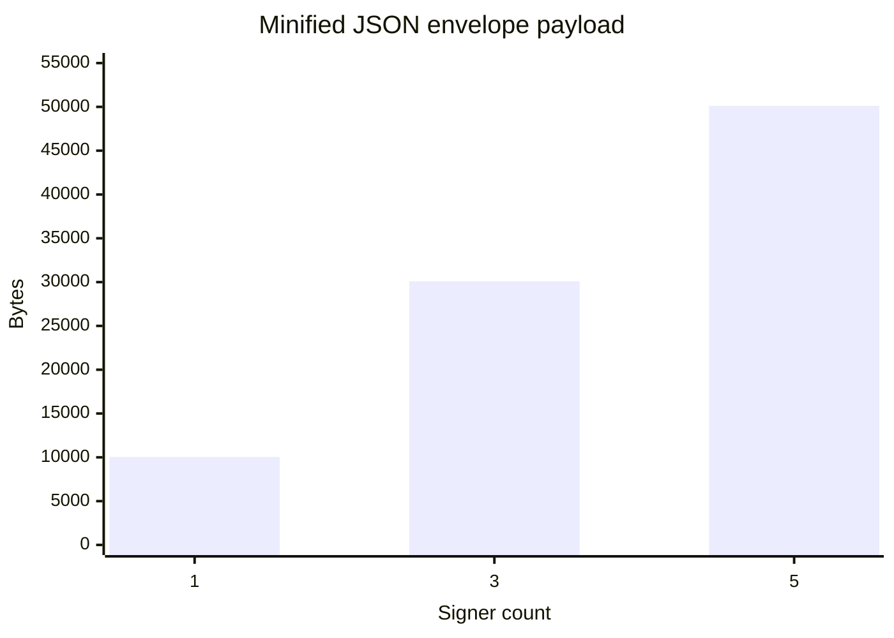
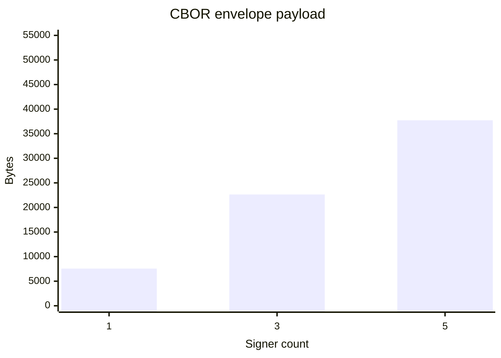

# MJKSIG — Majik Signature Envelope Format

[](https://www.iana.org/assignments/media-types/application/vnd.majikah.mjksig)

**File Extension:** `.mjksig`
**Proposed Media Type:** `application/vnd.majikah.mjksig`
**Category:** Secure digital signature envelope
**Specification Version:** 1.2
**Current Format Version Byte:** `0x02` (CBOR; `0x01` JSON is legacy)
**Status:** Draft / Implementation-aligned

---

## 1. Overview

**MJKSIG (Majik Signature Envelope)** is a self-contained, detached digital signature binary format. It is designed to carry cryptographic proofs of file integrity, authorship, and signing policies (multi-sig and allowlists) independently of the file it signs. 

The format employs a **hybrid cryptographic construction**, requiring signatures from both a classical elliptic curve algorithm (**Ed25519**) and a post-quantum algorithm (**ML-DSA-87**). The binary structure acts as a lightweight wrapper around a `MultiSigEnvelope` payload. New containers encode this payload as CBOR; legacy containers encode it as UTF-8 JSON.

---

## 2. Cryptographic Model

MJKSIG relies on a hybrid signature model ensuring resilience against both classical and quantum computing attacks.

### 2.1 Hybrid Signatures
Every valid signatory entry within an MJKSIG envelope contains two distinct signatures:
*   **Ed25519 Signature:** 64 bytes, stored as base64.
*   **ML-DSA-87 Signature:** 4627 bytes, stored as base64.

Both algorithms sign the exact same **canonical payload** bytes. Verification requires **both** signatures to pass; if either fails, the entire signature is deemed invalid.

### 2.2 Canonical Payload
The canonical signing payload is constructed deterministically to ensure byte-for-byte identical inputs during both signing and verification.

**Format:**
`"majik-signature-v1:" + JSON.stringify({ v, id, ts, ct, hash[, alh][, vu][, vch] })`

Where:
*   `v`: Envelope version (integer, `1`).
*   `id`: Signer fingerprint (string).
*   `ts`: ISO 8601 timestamp (string).
*   `ct`: Content type or `null`.
*   `hash`: SHA-256 hash of the original detached file's content, base64 encoded.
*   `alh`: SHA-256 hash of the canonical allowlist JSON, base64 encoded. This key is completely omitted (not set to `null`) if an allowlist is not established, preserving backward compatibility.
*   `vu`:  Optional ISO 8601 expiry. When present, verify() treats the signature as invalid once the current time is past this value. Absent = never expires (matches all pre-existing signatures — fully backward compatible). Covered by the canonical signing payload when present, so it cannot be stripped or extended post-hoc without breaking both signatures.
*   `vch`: Optional SHA-256 hash of the `fileVersions` revision chain, base64 encoded, as it stood when this signer signed (including their own new entry). Present only on files using file versioning (see §2.4). Omitted entirely, never `null`, on any signature that predates or doesn't use this feature — preserves the same backward-compatibility guarantee as `alh`/`vu`.

### 2.3 Allowlist and Sealing
*   **Allowlist:** The first signer may optionally restrict future signers by embedding an `ExpectedSigner` array. The establisher commits to this allowlist cryptographically via the `allowlistHash` in their canonical payload.
*   **Seal:** The issuer (allowlist establisher) can permanently lock the envelope against further signatures. Sealing computes a SHA3-512 hash over the current signatories and a seal timestamp. The seal hash domain prefix is `majik-seal-v1:`. 
  
### 2.4 File Versioning & Revision Chains

MJKSIG supports an append-only revision chain (`fileVersions`) for workflows where a signer visually mutates the document itself (e.g. a drawn signature stamp) before signing — which changes the file's byte content on every hand-off, not just its metadata.

Each entry in `fileVersions` is a `FileVersion`:

```typescript
interface FileVersion {
  /** Sequential, 1-indexed */
  version: number;
  timestamp: string; // ISO 8601
  /** SHA-256 of this revision's stripped bytes, base64 */
  contentHash: string;
  /** SHA-256 of the entire prior FileVersion entry — absent only on version 1 */
  previousVersionHash?: string;
  createdBy?: string; // signer fingerprint
  message?: string;
}
```

Two independent integrity mechanisms apply:

1. **Structural chaining** — each entry's `previousVersionHash` is the hash of the complete prior `FileVersion` object (not just its `contentHash`), so tampering with any field of an earlier entry — including `timestamp` or `message` — breaks the chain at that point. Checked via a walk of the array; requires no cryptographic key.
2. **Cryptographic binding** — each signer's `versionChainHash` (§2.2) commits to `SHA256(JSON.stringify(fileVersions[0..their own new entry]))`. This is what prevents a wholesale, internally-consistent forged chain: without it, an attacker with file-edit access could rewrite `fileVersions` end-to-end in a way that still passes the structural check in (1), since that check alone never touches a signature. `versionChainHash` anchors the chain's *state at that signer's turn* to a value only they could have produced.

Verifiers should treat a file as chain-valid only when **both** checks pass for every signature — structural chaining alone is a self-consistency check, not a security property.

**Self-contained vs. archive-assisted verification.** Because a raw content hash alone can't be recomputed for an *earlier* revision without the earlier bytes, two levels of verification exist:

- **Commitment verification** (self-contained, no earlier bytes needed): recompute the canonical payload from the stored `MajikSignatureJSON` fields, verify Ed25519 + ML-DSA-87 against it, and confirm `versionChainHash` matches the recomputed prefix of `fileVersions`. This proves the signer's commitment is genuine and the chain hasn't been rewritten, but does not independently prove the `contentHash` at that revision ever corresponded to real bytes.
- **Full revision verification** (archive-assisted): given the actual byte content of each historical revision, confirm each one's hash matches its `fileVersions` entry and that the full signature verifies against those bytes directly. This is the only way to fully close the gap left by commitment verification, and requires the verifier to have retained each intermediate revision.

`fileVersions` is intentionally metadata-only — it never stores revision content directly, to avoid the container growing linearly with each signer for large files. Storage of the actual per-revision bytes, if needed for full revision verification, is left to the application layer.

---

## 3. Binary Layout

All multi-byte integer fields are **big-endian**.

The file begins with a strictly sized **12-byte header** regardless of the version. The format version byte selects the payload encoding: version `0x01` is legacy UTF-8 JSON, and version `0x02` is the current CBOR encoding. New files are written as version `0x02`; implementations conforming to this specification accept both versions.

```text
Offset  Length  Field
──────  ──────  ──────────────────────────────────────────────────
0       6       Magic bytes: ASCII "MJKSIG" (0x4D 0x4A 0x4B 0x53 0x49 0x47)
6       1       Format version: 0x02 (current CBOR); 0x01 (legacy JSON)
7       1       Reserved byte
8       4       Payload byte length (big-endian uint32)
12      N       Payload, encoded according to the format version
```

### 3.1 Field Definitions

| Field          | Offset | Length  | Encoding          | Description                                                                   |
| -------------- | ------ | ------- | ----------------- | ----------------------------------------------------------------------------- |
| Magic          | 0      | 6 bytes | Raw bytes         | ASCII "MJKSIG" — `0x4d, 0x4a, 0x4b, 0x53, 0x49, 0x47`.                        |
| Version        | 6      | 1 byte  | Unsigned integer  | Payload encoding version: current `0x02` (CBOR); legacy `0x01` (JSON).        |
| Reserved       | 7      | 1 byte  | Raw byte          | Reserved for future use. Must currently be `0x00`.                            |
| Payload length | 8      | 4 bytes | Big-endian uint32 | Byte length of the following payload (`N`).                                  |
| Payload        | 12     | N bytes | Version-specific | The `MultiSigEnvelope` data: UTF-8 JSON for v1, CBOR for v2.                  |

---

## 4. Payload Schema

The payload section located at byte offset `12` represents the `MultiSigEnvelope` schema. The interfaces below describe its logical, JSON-compatible form. Version 1 serializes this form as UTF-8 JSON. Version 2 serializes it as CBOR as described in §4.4.

The container version is independent of the `version` fields within the envelope and per-signer records. Those schema versions remain `1` in both payload encodings.

### 4.1 MultiSigEnvelope (Root Object)

```typescript
interface MultiSigEnvelope {
  /** Envelope wrapper version — must equal 1 */
  version: 1;

  /** Restricts signing to these keys only. Absent = open signing. */
  allowlist?: ExpectedSigner[];

  /** Fingerprint of the signer who established the allowlist. */
  allowlistSignerId?: string;

  /** All per-signer envelopes. One entry per signer. */
  signatures: MajikSignatureJSON[];

  /** SHA3-512 hash of the canonical seal payload, hex-encoded (128 chars). */
  sealHash?: string;

  /** ISO 8601 timestamp of when the seal was applied. */
  sealTimestamp?: string;

  /** Fingerprint of the issuer who applied the seal. */
  sealedBy?: string;
  
  /** Multi-chain-ready anchor receipts. */
  chainAnchors?: MajikChainAnchor[];

   /** Append-only revision chain. Absent on files predating this feature. */
  fileVersions?: FileVersion[];
}
```

### 4.2 MajikSignatureJSON (Per-Signer Entry)

Every entry in the `signatures` array adheres to the following interface:

```typescript
interface MajikSignatureJSON {
  /** Envelope version — must equal MAJIK_SIGNATURE_VERSION */
  version: 1;

  /** MajikKey fingerprint (SHA-256 of X25519 public key, base64) */
  signerId: MajikKeyFingerprint;

  /** Ed25519 public key, base64 (32 bytes) */
  signerEdPublicKey: string;

  /** ML-DSA-87 public key, base64 (2592 bytes) */
  signerMlDsaPublicKey: string;

  /** SHA-256 hash of the original content, base64 (32 bytes → 44 chars) */
  contentHash: string;

  /** Advisory content type — e.g. "audio/wav", "application/pdf" */
  contentType?: string;

  /** ISO 8601 timestamp of when the signature was created */
  timestamp: ISODateString;

  /** Ed25519 signature over the canonical payload, base64 (64 bytes) */
  edSignature: ED25519Signature;

  /** ML-DSA-87 signature over the canonical payload, base64 (4627 bytes) */
  mlDsaSignature: MLDSA87Signature;

  /** SHA-256 hash of the canonical allowlist JSON, base64 (44 chars). */
  allowlistHash?: string;

   /**
   * Optional ISO 8601 expiry. When present, verify() treats the signature
   * as invalid once the current time is past this value. Absent = never
   * expires (matches all pre-existing signatures — fully backward compatible).
   * Covered by the canonical signing payload when present, so it cannot be
   * stripped or extended post-hoc without breaking both signatures.
   */
   validUntil?: ISODateString;

    /**
   * SHA-256 of the fileVersions chain as it stood when this signer signed
   * (i.e. including their own new entry). Covered by the canonical payload,
   * same treatment as allowlistHash/validUntil — absent, never null.
   */
  versionChainHash?: string;
  
  /** Trusted Timestamp Authority metadata and signature */
  tsa?: MajikTimestamp;
}
```

### 4.3 ExpectedSigner

Used within the `allowlist` array to mandate exact key matches.

```typescript
interface ExpectedSigner {
  signerId: string;
  edPublicKey: string;
  mlDsaPublicKey: string;
}
```
*Note: All three fields must match during the signing-eligibility gate to prevent spoofing by a different key pair sharing the same fingerprint.*

### 4.4 CBOR Payload Encoding (Container Version 2)

Version 2 encodes the envelope as a CBOR map using ordinary CBOR maps and byte strings (no CBOR record extensions). Map keys use the field names shown in §§4.1–4.3; nested objects and arrays retain their schema structure.

Binary values represented as Base64 or hexadecimal strings in the logical schema are encoded as native CBOR byte strings in v2. This includes fingerprints, public keys, signatures, content hashes, allowlist hashes, version-chain hashes, and seal hashes. Timestamps, content types, messages, and other textual fields remain CBOR text strings; numeric and boolean values retain their corresponding CBOR types. Optional fields remain absent when not set.

This encoding change affects only container serialization. It does not change the canonical signing payload, signature algorithms, or verification rules in §2. A reader chooses the decoder from the container version byte: v1 JSON or v2 CBOR. Reading legacy v1 containers does not mean older implementations can read v2 containers.

### 4.5 Payload Size Comparison and Improvements

CBOR reduces envelope payload size by representing cryptographic values as binary byte strings instead of Base64 or hexadecimal text, and by avoiding JSON syntax and textual number encoding. The logical envelope fields and signing semantics are unchanged.

The following measurements compare the minified JSON envelope payload with the raw CBOR envelope payload, averaged across the repository's PDF, JPEG, and WAV fixtures. The charts use the same byte scale. Values are payload bytes only; the 12-byte MJKSIG container header is excluded. Both encodings contain the same envelope data.





| Signers | Minified JSON | Raw CBOR | Bytes saved | Reduction |
| ------: | ------------: | -------: | ----------: | --------: |
| 1       | 10,046 B      | 7,564 B  | 2,482 B     | 24.71%    |
| 3       | 30,082 B      | 22,644 B | 7,438 B     | 24.73%    |
| 5       | 50,118 B      | 37,724 B | 12,394 B    | 24.73%    |

Across all 15 fixture-and-signer-count samples (three fixtures and signer counts 1–5), the average payload was **30,082 B as JSON** and **22,644 B as CBOR**, a **24.73% reduction**. These byte counts were captured from a benchmark run on 2026-10-19; they are serialization-size measurements, not timing statistics. Results are specific to this envelope schema and benchmark fixtures; applications should measure their own envelopes if exact storage estimates matter. Re-run with `npm run benchmark:serialization` to reproduce the measurements.

**Improvements in v2:** smaller payloads; native binary representation for cryptographic fields; the same fixed 12-byte header with an explicit encoding version; and a versioned migration path that preserves read compatibility with v1 JSON. CBOR is binary and is not directly human-readable like JSON; tools must select the decoder from the version byte.

---

## 5. File Identification

| Property             | Value                            |
| -------------------- | -------------------------------- |
| Magic bytes          | `4D 4A 4B 53 49 47`              |
| ASCII representation | `MJKSIG`                         |
| Offset               | `0x00`                           |
| Minimum valid header | 12 bytes                         |
| File Extension       | `.mjksig`                        |
| MIME Type            | `application/vnd.majikah.mjksig` |

---

## 6. Parsing & Verification Pipeline

1.  **Header Verification:** Read the first 6 bytes and verify the `MJKSIG` magic sequence.
2.  **Version Check:** Read byte offset `6`; accept `0x01` (legacy JSON) or `0x02` (current CBOR).
3.  **Read Payload Length:** Extract the 4-byte big-endian `uint32` starting at offset `8`.
4.  **Decode Payload:** Read the specified number of bytes starting at offset `12`. Decode as UTF-8 JSON for container version `0x01`, or as CBOR for version `0x02`, then validate the resulting `MultiSigEnvelope`.
5.  **Target Verification:** For a target signature in the `signatures` array:
    *   Compute the SHA-256 hash of the detached original file and ensure it base64-matches `contentHash`.
    *   Reconstruct the deterministic canonical byte payload.
    *   Verify the classical `edSignature` against `signerEdPublicKey`.
    *   Verify the post-quantum `mlDsaSignature` against `signerMlDsaPublicKey`.
6.  **Version Chain Verification (if `fileVersions` is present):** Walk the chain confirming each entry's `previousVersionHash` matches the hash of the prior entry (§2.4.1), then for each signature carrying a `versionChainHash`, recompute the hash of the chain prefix up to and including its corresponding entry and confirm it matches.

If all checks pass, the detached signature securely correlates to the file.

---

## Author

Developed by **Josef Elijah Fabian (Zelijah)** | [Majikah Solutions OPC](https://majikah.solutions/about)


**Developer**: [Josef Elijah Fabian](https://github.com/jedlsf)
**GitHub**: [https://github.com/Majikah](https://github.com/Majikah)
**Project Repository**: [https://github.com/Majikah/majik-signature](https://github.com/Majikah/majik-signature)

---

## Contact

- **Business Email**: [business@majikah.solutions](mailto:business@majikah.solutions)
- **Official Website**: [https://www.thezelijah.world](https://www.thezelijah.world)
- **Majikah Ecosystem**: [https://majikah.solutions](https://majikah.solutions)